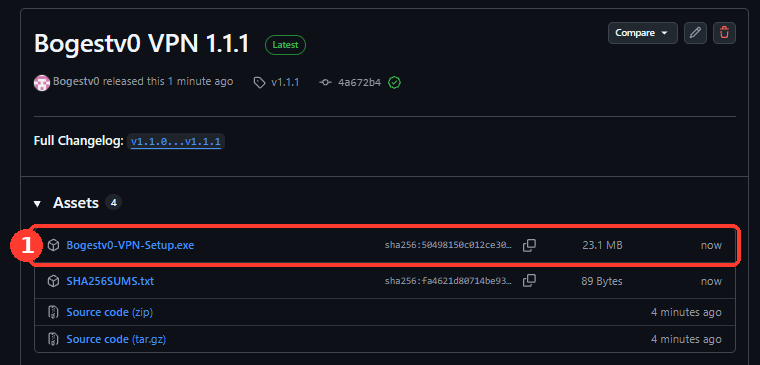
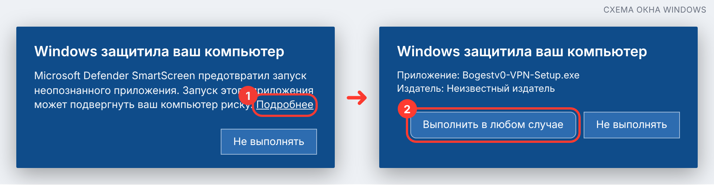
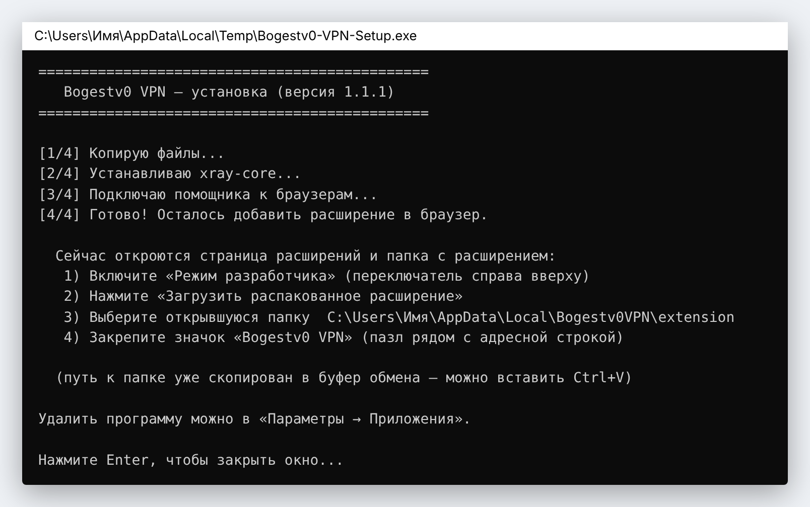
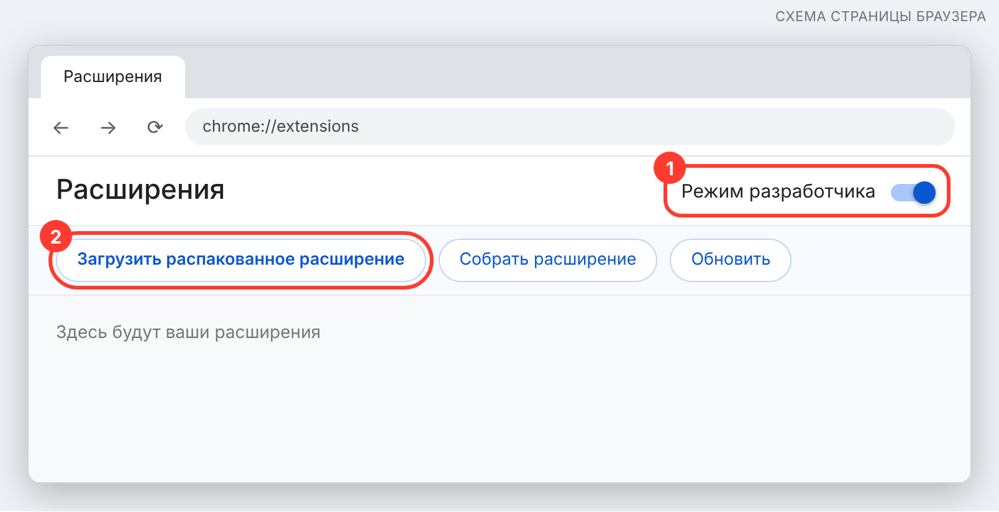
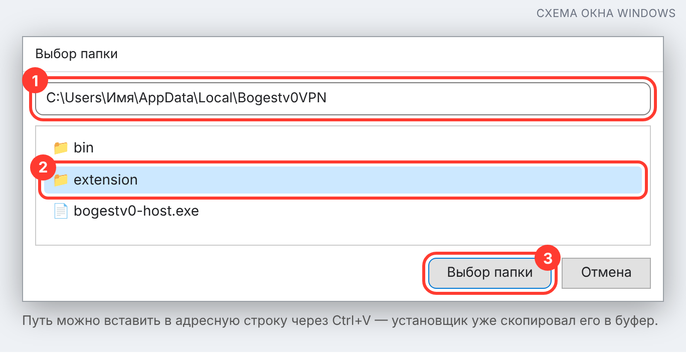
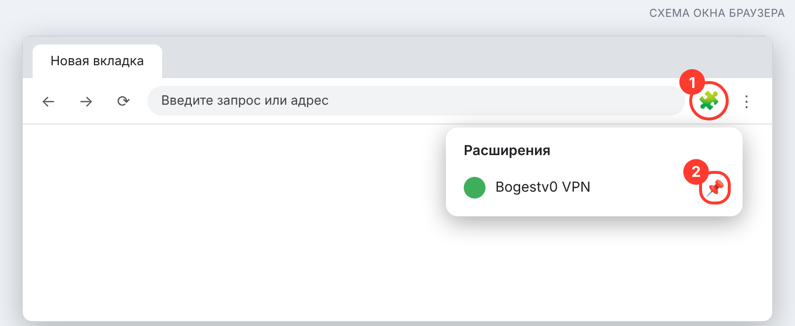
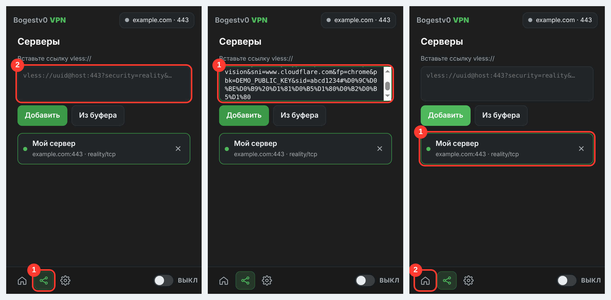
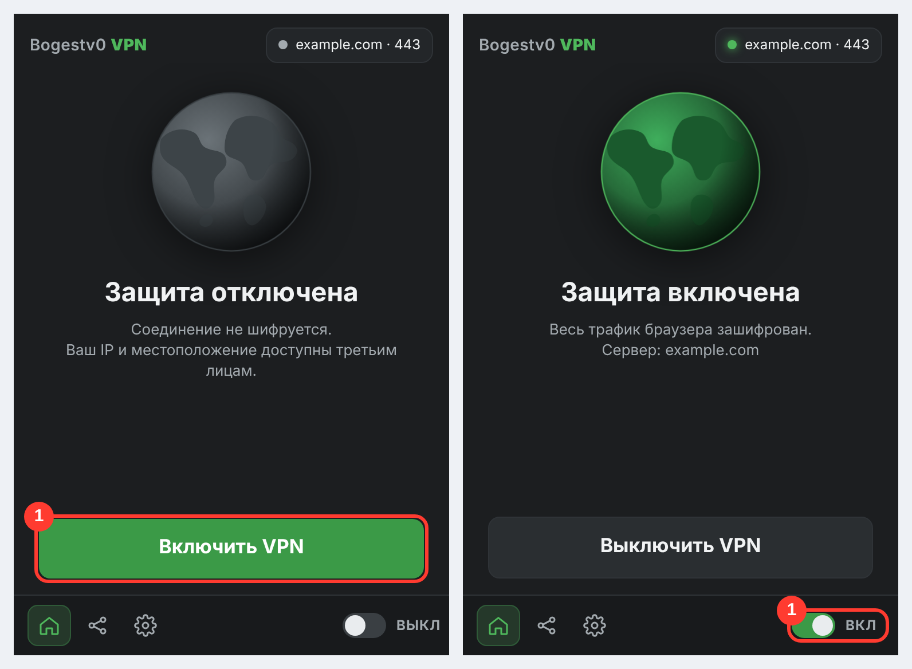

# Bogestv0 VPN

Расширение для Chrome / Edge / Brave: вставляете ссылку `vless://…` — и весь трафик браузера идёт через ваш сервер (VLESS + Reality, XTLS Vision).


---

## Установка (Windows) — пошагово с картинками


https://github.com/user-attachments/assets/4fcc156d-ed89-45b9-8e34-f02963f52570


> Картинки со словом **«схема»** нарисованы для наглядности: у вас окна могут выглядеть чуть иначе (другая версия Windows или браузера), но кнопки и порядок действий те же. Картинки интерфейса расширения и страницы GitHub — настоящие.

### Что понадобится
* Windows 10 / 11
* Браузер на Chromium: Chrome, Edge, Brave, Vivaldi
* Ваша личная ссылка `vless://…` (выдаёт администратор)

---

### Шаг 1. Скачайте установщик
Откройте **[Releases](../../releases/latest)** и в списке **Assets** нажмите на файл **`Bogestv0-VPN-Setup.exe`** (на картинке отмечен цифрой 1). Файл сохранится в папку «Загрузки».



---

### Шаг 2. Запустите его
Дважды щёлкните по скачанному файлу.

Windows может показать синее окно **«Windows защитила ваш компьютер»** — так бывает с любыми программами без платной цифровой подписи. Это не значит, что файл опасный.
1. Нажмите **«Подробнее»**.
2. Нажмите **«Выполнить в любом случае»**.



Проверить, что файл не подменён, можно по контрольной сумме — см. [Проверка файла](#проверка-файла).

---

### Шаг 3. Дождитесь окончания установки
Откроется чёрное окно, установка занимает около минуты. В конце появится надпись **«Готово!»**, откроется страница расширений браузера и папка с расширением. **Окно не закрывайте**, пока не выполните шаг 4.



---

### Шаг 4. Добавьте расширение в браузер (один раз)
На открывшейся странице `chrome://extensions` (в Edge — `edge://extensions`):

1. Включите **«Режим разработчика»** — переключатель справа вверху (в Edge слева внизу).
2. Нажмите **«Загрузить распакованное расширение»**.



Откроется окно выбора папки:

1. Вставьте в адресную строку путь через `Ctrl+V` (установщик уже скопировал его в буфер) или перейдите вручную: `C:\Users\<ваше имя>\AppData\Local\Bogestv0VPN`. Папка `AppData` скрытая — проще вставить путь.
2. Выделите папку **`extension`**.
3. Нажмите **«Выбор папки»**.



---

### Шаг 5. Закрепите значок расширения
1. Нажмите на значок пазла 🧩 справа от адресной строки.
2. Нажмите на значок кнопки-булавки 📌 рядом с «Bogestv0 VPN» — значок закрепится на панели.



---

### Шаг 6. Перезапустите браузер
**Полностью закройте все окна браузера** и откройте снова. Без этого браузер не увидит помощника, и расширение напишет «Не найден локальный помощник».

---

### Шаг 7. Добавьте свою ссылку
1. Нажмите на значок расширения и откройте вкладку **«Серверы»** (вторая иконка внизу, на картинке 1).
2. Скопируйте свою ссылку `vless://…` и вставьте в поле (**`Ctrl+V`**) — она **добавится сама**, нажимать ничего не нужно. Можно также нажать **«Из буфера»**.
3. Ссылка появится в списке с зелёной рамкой — это выбранный сервер. Вернитесь на главную (значок домика).

Если ссылка неверная, под полем появится красная подсказка. Добавить можно несколько серверов — выбирайте нужный нажатием. Удалить сервер: крестик справа в строке.



*(На картинке ссылка и сервер — условные примеры.)*

---

### Шаг 8. Включите VPN
Нажмите большую зелёную кнопку **«Включить VPN»**. Через пару секунд появится надпись **«Защита включена»**, глобус станет зелёным, а на значке расширения — метка **ON**. Выключается той же кнопкой или переключателем внизу справа.



Проверьте: откройте [2ip.ru](https://2ip.ru) — должен показаться IP вашего сервера, а не ваш домашний.

---

## Как пользоваться

| Что | Как |
|---|---|
| Включить / выключить | Большая кнопка или переключатель внизу справа |
| Сменить сервер | Вкладка «Серверы» → нажать на нужный |
| Весь трафик через VPN | «Настройки» → режим **«Весь трафик»** |
| VPN только для некоторых сайтов | «Настройки» → **«Только сайты из списка»**, добавьте домены. Кнопка «Добавить отдельное VPN правило для …» на главной добавляет текущий сайт |
| Сменить локальный порт | «Настройки» → «Локальный порт SOCKS5» (по умолчанию 10808) |

VPN работает **только для браузера**, в котором установлено расширение, а не для всей системы.

---

## Если что-то не работает

| Сообщение / симптом | Что делать |
|---|---|
| «Не найден локальный помощник» | Вы не перезапустили браузер полностью (шаг 4) или установка не завершилась — запустите `Bogestv0-VPN-Setup.exe` ещё раз |
| «Порт … уже занят другой программой» | «Настройки» → поменяйте порт на редкий, например `23456` (часто порт занимает другой VPN-клиент, например v2rayN) |
| «xray не запустился …» | Откройте `%LOCALAPPDATA%\Bogestv0VPN\xray.log` и пришлите администратору. Обычно причина — неверная ссылка или сервер недоступен |
| «Настройки → Помощник: xray не найден» | Запустите установщик заново |
| Установщик не смог скачать xray | Скачайте `Xray-windows-64.zip` с [github.com/XTLS/Xray-core/releases](https://github.com/XTLS/Xray-core/releases) и положите `xray.exe` в `%LOCALAPPDATA%\Bogestv0VPN\bin\` |
| После включения не открываются сайты | Проверьте, что ссылка актуальна и сервер работает. Попробуйте выключить и включить VPN |
| Браузер пишет про «расширения в режиме разработчика» | Это сообщение Chrome для расширений, добавленных вручную. Его можно закрыть |

## Удаление
**Параметры → Приложения → Установленные приложения → Bogestv0 VPN → Удалить.**
Затем удалите расширение в `chrome://extensions`.

---

## Безопасность
* Ваша ссылка `vless://` — это личный ключ. **Не передавайте её другим**: по ней можно пользоваться вашим доступом.
* Ссылки хранятся только локально в вашем браузере (`chrome.storage`) и никуда не отправляются.
* Расширение направляет на VPN только трафик браузера; xray слушает лишь `127.0.0.1` и недоступен из сети.

## Проверка файла
Рядом с установщиком в Releases лежит `SHA256SUMS.txt`. В PowerShell:

```powershell
Get-FileHash .\Bogestv0-VPN-Setup.exe -Algorithm SHA256
```
Значение должно совпасть с записью в `SHA256SUMS.txt`.

---

## Как это устроено
```
Браузер → расширение → помощник (bogestv0-host.exe) → xray-core → ваш сервер
```
Браузерное расширение не умеет само работать по VLESS/Reality — оно может только направить трафик на локальный прокси. Поэтому установщик ставит маленького помощника, который по команде расширения запускает `xray-core` на `127.0.0.1:10808`, а расширение направляет через него трафик браузера (PAC-скрипт).

## Для разработчиков

```
extension/   расширение (Manifest V3)
helper/      помощник (Go): native messaging + запуск xray
installer/   установщик (Go): всё вшивается в один .exe
build.sh     сборка
```

**Сборка** (нужен Go 1.21+):
```bash
./build.sh                 # → dist/Bogestv0-VPN-Setup.exe
# положите xray.zip (Xray-windows-64.zip) рядом — тогда xray вшивается в установщик
```


## Ссылка-подписка (v1.1)

В поле можно вставить **ссылку-подписку из бота** (`/myvpn`) — ту же, что и в приложениях Happ/v2RayTun/INCY. Браузер займёт одно из мест («Browser Chrome») и появится в списке устройств в боте и кабинете. При каждом включении расширение заново берёт ключ из подписки, поэтому «Отвязать» в боте сразу отключает браузер. Ключ `vless://` по-прежнему можно вставить вручную, но такое подключение место не занимает.

## Что нового в 1.2

* **IP, IPv6 и пинг** на главном экране (кнопка ↻ обновляет). IP определяют `api.ipify.org` и `api6.ipify.org` (запрос идёт тем же путём, что и ваш трафик: при включённом VPN вы видите IP сервера). Пинг — время TCP-соединения помощника с вашим сервером.
* **Обновления с GitHub.** Расширение раз в 6 часов смотрит последний релиз (`GH_REPO` в `extension/background.js`) и, если версия новее, показывает сверху «Доступна версия … Хотите обновить?». Кнопка «Обновить» скачивает `Bogestv0-VPN-Setup.exe` — запустите его и перезапустите браузер. «Позже» прячет эту версию. Версия расширения при релизе берётся из тега (`v1.3.0` → `1.3.0`).
* **Исправить DNS** («Настройки»). Ставит DNS Cloudflare и Google (1.1.1.1 / 8.8.8.8, IPv4 и IPv6) на активные Wi-Fi/Ethernet-адаптеры; Windows спросит подтверждение (UAC). Прежние настройки запоминаются в `%LOCALAPPDATA%\Bogestv0VPN\dns-backup.json`, кнопка «Вернуть как было» возвращает их (или автоматический DNS, если сохранённых нет). Нужен свежий установщик: старый помощник этих команд не знает.

> Пинг и DNS работают через помощника, поэтому после обновления расширения один раз запустите новый `Bogestv0-VPN-Setup.exe`.
