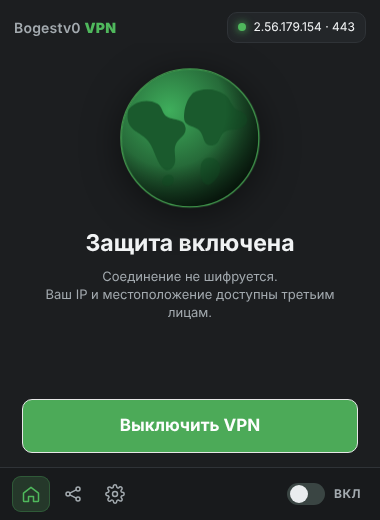

# Bogestv0 VPN

Расширение для Chrome / Edge / Brave: вставляете ссылку `vless://…` — и весь трафик браузера идёт через ваш сервер (VLESS + Reality, XTLS Vision).



---

## Установка (Windows)

### Что понадобится
* Windows 10 / 11
* Браузер на Chromium: Chrome, Edge, Brave, Vivaldi
* Ваша личная ссылка `vless://…` (выдаёт администратор)

### Шаг 1. Скачайте установщик
Откройте страницу **[Releases](../../releases/latest)** и скачайте файл **`Bogestv0-VPN-Setup.exe`**.

### Шаг 2. Запустите его
Дважды щёлкните по файлу.

> Windows может показать синее окно **«Windows защитила ваш компьютер»** — это нормально для программ без платной цифровой подписи.
> Нажмите **«Подробнее» → «Выполнить в любом случае»**.
> Проверить, что файл не подменён, можно по контрольной сумме (см. [Проверка файла](#проверка-файла)).

Откроется чёрное окно, установка занимает около минуты. В конце оно откроет страницу расширений браузера и папку с расширением.

### Шаг 3. Добавьте расширение в браузер (один раз)
На открывшейся странице `chrome://extensions` (в Edge — `edge://extensions`):

1. Включите **«Режим разработчика»** — переключатель справа вверху (в Edge слева внизу).
2. Нажмите **«Загрузить распакованное расширение»**.
3. Выберите папку, которую открыл установщик. Путь уже скопирован в буфер — его можно вставить через `Ctrl+V`.
   По умолчанию это `C:\Users\<ваше имя>\AppData\Local\Bogestv0VPN\extension`.
4. Нажмите значок пазла рядом с адресной строкой и **закрепите** «Bogestv0 VPN».

### Шаг 4. Перезапустите браузер
**Полностью закройте все окна браузера** и откройте снова. Без этого браузер не увидит помощника.

### Шаг 5. Добавьте свою ссылку и включите
1. Нажмите на значок расширения.
2. Откройте вкладку **«Серверы»** (вторая иконка внизу).
3. Вставьте свою ссылку `vless://…` — она добавится автоматически.
4. Вернитесь на главную (иконка домика) и нажмите **«Включить VPN»**.
5. Проверьте, что всё работает: откройте [2ip.ru](https://2ip.ru) — IP должен совпадать с IP вашего сервера.

---

## Как пользоваться

| Что | Как |
|---|---|
| Включить / выключить | Большая кнопка или переключатель внизу справа |
| Сменить сервер | Вкладка «Серверы» → нажать на нужный |
| Весь трафик через VPN | «Настройки» → режим **«Весь трафик»** |
| VPN только для некоторых сайтов | «Настройки» → **«Только сайты из списка»**, добавьте домены. Кнопка «Добавить отдельное VPN правило для …» на главной добавляет текущий сайт |
| Сменить локальный порт | «Настройки» → «Локальный порт SOCKS5» (по умолчанию 10808) |

VPN работает **только для браузера**, в котором установлено расширение, а не для всей системы.

---

## Если что-то не работает

| Сообщение / симптом | Что делать |
|---|---|
| «Не найден локальный помощник» | Вы не перезапустили браузер полностью (шаг 4) или установка не завершилась — запустите `Bogestv0-VPN-Setup.exe` ещё раз |
| «Порт … уже занят другой программой» | «Настройки» → поменяйте порт на редкий, например `23456` (часто порт занимает другой VPN-клиент, например v2rayN) |
| «xray не запустился …» | Откройте `%LOCALAPPDATA%\Bogestv0VPN\xray.log` и пришлите администратору. Обычно причина — неверная ссылка или сервер недоступен |
| «Настройки → Помощник: xray не найден» | Запустите установщик заново |
| Установщик не смог скачать xray | Скачайте `Xray-windows-64.zip` с [github.com/XTLS/Xray-core/releases](https://github.com/XTLS/Xray-core/releases) и положите `xray.exe` в `%LOCALAPPDATA%\Bogestv0VPN\bin\` |
| После включения не открываются сайты | Проверьте, что ссылка актуальна и сервер работает. Попробуйте выключить и включить VPN |
| Браузер пишет про «расширения в режиме разработчика» | Это сообщение Chrome для расширений, добавленных вручную. Его можно закрыть |

## Удаление
**Параметры → Приложения → Установленные приложения → Bogestv0 VPN → Удалить.**
Затем удалите расширение в `chrome://extensions`.

---

## Безопасность
* Ваша ссылка `vless://` — это личный ключ. **Не передавайте её другим**: по ней можно пользоваться вашим доступом.
* Ссылки хранятся только локально в вашем браузере (`chrome.storage`) и никуда не отправляются.
* Расширение направляет на VPN только трафик браузера; xray слушает лишь `127.0.0.1` и недоступен из сети.

## Проверка файла
Рядом с установщиком в Releases лежит `SHA256SUMS.txt`. В PowerShell:

```powershell
Get-FileHash .\Bogestv0-VPN-Setup.exe -Algorithm SHA256
```
Значение должно совпасть с записью в `SHA256SUMS.txt`.

---

## Как это устроено
```
Браузер → расширение → помощник (bogestv0-host.exe) → xray-core → ваш сервер
```
Браузерное расширение не умеет само работать по VLESS/Reality — оно может только направить трафик на локальный прокси. Поэтому установщик ставит маленького помощника, который по команде расширения запускает `xray-core` на `127.0.0.1:10808`, а расширение направляет через него трафик браузера (PAC-скрипт).

## Для разработчиков

```
extension/   расширение (Manifest V3)
helper/      помощник (Go): native messaging + запуск xray
installer/   установщик (Go): всё вшивается в один .exe
build.sh     сборка
```

**Сборка** (нужен Go 1.21+):
```bash
./build.sh                 # → dist/Bogestv0-VPN-Setup.exe
# положите xray.zip (Xray-windows-64.zip) рядом — тогда xray вшивается в установщик
```

**Выпуск релиза.** Создайте и отправьте тег — GitHub Actions соберёт установщик и выложит его в Releases:
```bash
git tag v1.1.0
git push origin v1.1.0
```

**Chrome Web Store / Edge Add-ons.** После публикации расширения в магазине задайте переменную репозитория `STORE_IDS` (Settings → Secrets and variables → Actions → Variables) с ID из магазина (через запятую, если несколько). Установщик перестанет просить «Режим разработчика», а пользователи будут ставить расширение из магазина в один клик.

> ID распакованного расширения фиксирован (`cfilndkhacojgcfnepiiljkpaikemkgc`) благодаря полю `key` в `manifest.json`. Менять `key` нельзя — иначе помощник перестанет принимать расширение.

Только Windows + Chromium-браузеры. Firefox не поддерживается (другой API прокси).
